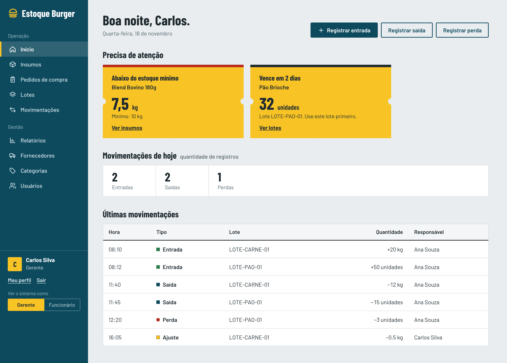
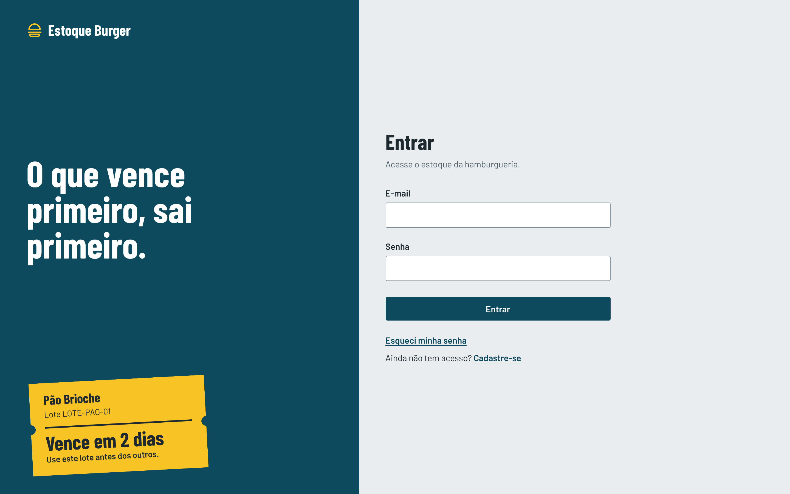
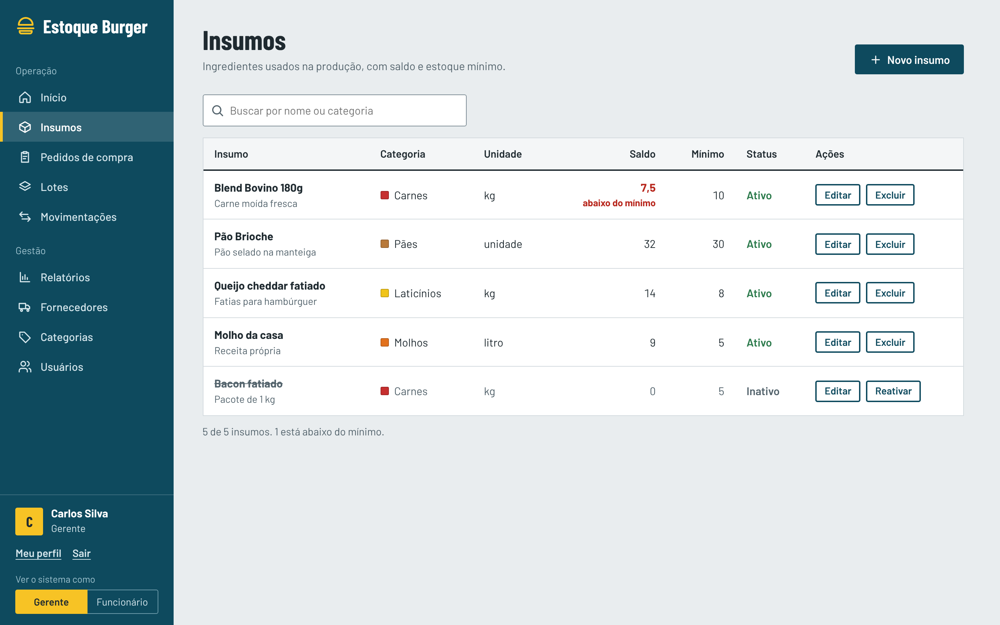

# BurgerStock

Sistema de gestão de estoque para hamburgueria de pequeno porte. Controla insumos, fornecedores, pedidos de compra, lotes com validade e movimentações de estoque, com dois perfis de acesso: Gerente e Funcionário.

Projeto de Extensão Comunitária (Curricularização) do Curso Superior de Tecnologia em Informática para Negócios da Fatec São José do Rio Preto, 2º semestre de 2026: desenvolvimento de um MPV (Mínimo Produto Viável) de software para gestão de uma organização.



## Problema

Em muitas hamburguerias o estoque é controlado à mão ou em planilhas. Isso causa divergência nas quantidades, perda de informação, dificuldade para achar produtos perto do vencimento e falta de controle sobre entradas, saídas e desperdícios. O BurgerStock centraliza essas informações e registra cada movimentação com data, motivo e responsável.

## Funcionalidades

- **Acesso:** criação de acessos, cadastre-se (todo novo cadastro entra como Funcionário), login, lembrete de senha, edição do próprio perfil e permissões por perfil.
- **Cadastros:** categorias, fornecedores (CNPJ único), insumos e a associação entre insumos e fornecedores.
- **Compras:** o Gerente faz pedidos de compra a um fornecedor, com quantidade e valor unitário de cada insumo. No recebimento, cada item vira um lote com código único e validade, e o sistema registra a entrada no estoque.
- **Estoque:** saídas para a produção (com conferência de saldo), perdas com motivo e ajuste de inventário. O saldo não é digitado: é calculado pelas movimentações de cada lote.
- **Consultas:** saldo por lote e por insumo, histórico de movimentações por período, alertas de estoque mínimo e de lotes perto do vencimento, indicadores e relatório de uso dos insumos.

O Funcionário faz as operações do dia a dia (receber pedidos e registrar entradas, saídas e perdas). O Gerente tem acesso a tudo, inclusive cadastros, pedidos de compra, ajustes e relatórios.

## Estrutura do repositório

```
BurgerStock/
├── java/                          código Java
│   ├── Main.java                  demonstração de todas as regras
│   └── entities/                  classes do sistema (diagrama de classes)
├── banco_de_dados/
│   └── burgerstock.sql            script do banco (SQL Server)
└── telas/telas_sistema_estoque/
    ├── telas_sistema_estoque.html protótipo das telas
    └── prints/                    imagens das telas
```

## Como executar

### Código Java

Precisa do JDK 11 ou mais novo (testado com o JDK 21).

No VS Code, com a extensão Extension Pack for Java: abra a pasta `java`, abra o `Main.java` e clique em **Run**.

Pelo terminal, dentro da pasta `java`:

```
javac -encoding UTF-8 -d out Main.java entities/*.java
java -cp out Main
```

O `Main.java` cadastra os usuários, fornecedores e insumos de exemplo, faz dois pedidos de compra, recebe os pedidos, registra saídas, uma perda e um ajuste, e mostra os resultados: saldo de 7,5 kg de carne e 32 pães, alerta de estoque mínimo para a carne, lote de pão vencendo em 2 dias e pedidos de R$ 658,00 e R$ 90,00. Também mostra as recusas das regras, como e-mail repetido, código de lote repetido e saída maior que o saldo.

### Banco de dados

Precisa do SQL Server 2016 ou mais novo e do SQL Server Management Studio (SSMS). Abra o `banco_de_dados/burgerstock.sql` no SSMS e aperte **F5**.

> **Atenção:** o script apaga o banco `burgerstock`, se ele já existir, e cria de novo. Não use em um banco com dados reais.

O script cria o banco, as tabelas, as views de saldo e de valor do pedido, os dados de exemplo (os mesmos do `Main.java`) e as consultas das funcionalidades.

Usuários de exemplo:

| Nome | Perfil | E-mail | Senha |
|---|---|---|---|
| Carlos Silva | Gerente | carlos@burger.com | carlos123 |
| Ana Souza | Funcionário | ana@burger.com | ana12345 |

As senhas ficam guardadas como hash SHA-256, tanto no banco quanto no Java.

### Telas

Abra `telas/telas_sistema_estoque/telas_sistema_estoque.html` em qualquer navegador; não precisa de internet. O botão **Ver o sistema como Gerente / Funcionário**, no menu lateral, troca o perfil e mostra os menus de cada um.

| Login | Insumos (cadastro) |
|---|---|
|  |  |

## Modelo de dados

O banco tem 10 tabelas:

- `pessoas`: dados comuns. `usuarios` e `fornecedores` usam o mesmo id da pessoa.
- `categorias` e `insumos`.
- `insumo_fornecedor`: relacionamento N:N entre insumos e fornecedores.
- `pedidos_compra` e `itens_pedido_compra`: relacionamento N:N entre pedidos e insumos.
- `lotes`: um lote para cada item recebido, com código único e validade.
- `movimentacoes_estoque`: entradas, saídas, perdas e ajustes de cada lote, com o usuário responsável.

As regras de negócio também estão no banco: chaves estrangeiras, valores aceitos para perfil, status e tipo de movimentação, código de lote único e quantidades positivas (só o ajuste pode ser negativo). A exclusão é lógica, pelo campo `ativo`, para não perder o histórico.

## Observações sobre o MPV

- O código Java não se conecta ao banco nem às telas. Ele guarda os dados em listas, que equivalem às tabelas do banco, e as regras são demonstradas pelo `Main.java`.
- As telas são um protótipo com dados de exemplo. Estão prontas as telas de login, cadastre-se, lembrete de senha, tela principal, cadastro de insumos e meu perfil. As demais opções do menu abrem o aviso "em desenvolvimento", e o botão **Sair** volta para o login.
- O envio do e-mail do lembrete de senha é simulado: o `Main.java` mostra a senha provisória na tela.

## Tecnologias

Java · SQL Server (T-SQL) · HTML, CSS e JavaScript · GitHub

## Equipe

| Integrante | Função |
|---|---|
| Ana Marcela Pivetta | Requisitos, Engenharia de Software e Banco de Dados |
| Taisa Caruline Miorin | Banco de Dados (modelagem e scripts) |
| Gabriel Zanuzo Memédio | Engenharia de Software e Desenvolvimento Java e Front-End |
| Gabriel Henrique Faca Parra | Desenvolvimento Back-End Java e Arquitetura de Software |
